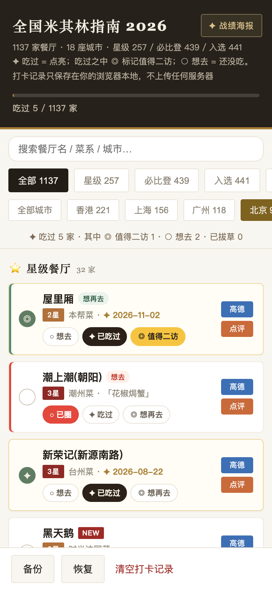
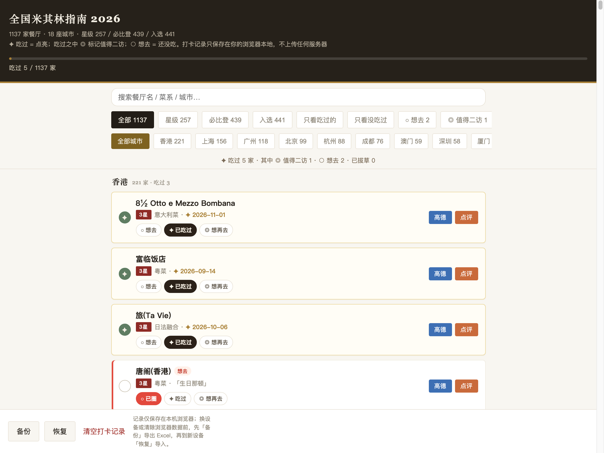

# 全国米其林指南 2026 · 打卡清单

**1137 家米其林餐厅，压缩成一份能打卡的清单。** 星级 / 必比登 / 入选一目了然，标记「想去 / 吃过 / 值得二访」，进度自动统计。单文件、免登录、数据只在你自己手里。

<p align="center">
  
  
</p>

> 截图中的打卡状态为演示数据。

## 为什么做这个

米其林官方指南和点评类平台都能**查**一家餐厅，但没有一个地方能回答吃货最想知道的三个问题：

1. **这份榜单我一共吃了多少家？** 官方不提供统计，没有「我的米其林进度」这种视图。
2. **我吃过哪些、还想再去哪些、一直惦记哪几家？** 攻略散在小红书收藏夹里，表格要自己一行行维护。
3. **下次去某座城市，还剩哪几家值得吃？** 得反复对照榜单和记忆。

于是把 2026 版指南的 1137 家全部整理进来，做成一份**可以一路打卡下去**的清单：按城市、按评级看，标记状态，看着进度条长起来。

## 数据一览

| 分类 | 数量 |
| --- | --- |
| 全部餐厅 | **1137** |
| 星级餐厅 | **257**（三星 12 / 二星 46 / 一星 199） |
| 必比登推介 | **439** |
| 指南入选 | **441** |
| 绿星餐厅 | 8 |
| 新上榜 / 新晋 | 261 |
| 覆盖城市 | **18** |

香港 221 · 上海 156 · 广州 118 · 北京 99 · 杭州 88 · 成都 76 · 澳门 59 · 深圳 58 · 厦门 43 · 南京 41 · 苏州 38 · 福州 31 · 台州 30 · 温州 24 · 泉州 18 · 扬州 16 · 常州 16 · 宁德 5

## 功能

- **三态打卡**：○ 想去 → ✦ 吃过 → ◎ 值得二访；「想去」可以写一句想吃什么，「想去 → 吃到」时自动留档「惦记了几天」
- **双重筛选**：评级（星级 / 必比登 / 入选）× 城市，再叠加「只看吃过的 / 没吃过的 / 想去的 / 想再去的」
- **搜索**：餐厅名、菜系、城市即时搜索
- **进度统计**：吃过 X / 1137、其中值得二访 Y 家、想去 Z 家
- **备份 / 恢复**：一键导出 Excel，换设备或清浏览器前先备份，新设备导入即合并
- **零依赖**：页面本体不请求任何外部资源，断网、飞机上、地铁里都能用

## 怎么用

### 方式一：直接打开（最快）

下载 `index.html`，用浏览器打开即可。iPhone 可以「添加到主屏幕」，像 App 一样用。

> 记录保存在浏览器 localStorage：**换浏览器、清浏览器数据会丢**，重要记录请先「备份」。同一台设备上不同浏览器之间互不相通。

### 方式二：托管到 GitHub Pages（推荐）

Fork 本仓库 → 仓库 Settings → Pages → 选择 `main` 分支根目录 → 得到自己的在线地址。功能与本地完全一致，依然是纯本地存储。

### 方式三：自己改

```bash
node script/build.js   # 从 data/michelin-guide-2026.json 重新生成 index.html
```

数据在 `data/michelin-guide-2026.json`，样式和交互在 `script/build.js`。想加自己的字段、换配色、改成别的榜单（黑珍珠、亚洲 50 最佳）都可以直接改。

> `index.html` 是构建产物，请改 `script/build.js` 后重新生成，不要直接手改——CI 会校验产物与源码是否一致。

## 边界与取舍

- **不做地图**：不包含餐厅坐标与地址，也不依赖任何地图服务的数据。「高德」「点评」按钮只是按餐厅名 + 城市跳转到对应站内搜索，方便你导航和看评价。
- **不做账号**：没有登录、没有云同步、没有埋点。代价是换设备要手动备份导入。
- **数据非官方**：整理自米其林指南公开信息，可能存在错漏或已过时，仅供参考。发现错误欢迎提 Issue 纠正。

## 反馈与建议

这个项目最需要两样东西：**数据纠错**和**真实使用反馈**。

- 🐛 [餐厅信息有误 / 缺漏 / 已闭店](https://github.com/nonlinearHuman/michelin-checklist-2026/issues/new?template=data-correction.yml) —— 请说明城市、餐厅名与正确信息，附来源更好
- 💡 [功能建议](https://github.com/nonlinearHuman/michelin-checklist-2026/issues/new?template=feature-request.yml) —— 你希望它多做什么，或哪里用着别扭
- 🆘 [使用问题](https://github.com/nonlinearHuman/michelin-checklist-2026/issues/new?template=bug-report.yml) —— 设备、浏览器、复现步骤

## 许可

- **代码**（`index.html`、`script/`）：[MIT](./LICENSE)
- **数据**（`data/`）：见 [LICENSE-DATA](./LICENSE-DATA.md)，整理自米其林指南公开信息，不适用 MIT
- 备份功能使用的 [SheetJS](https://sheetjs.com) 通过 CDN 按需加载（Apache-2.0），本仓库未分发其代码
