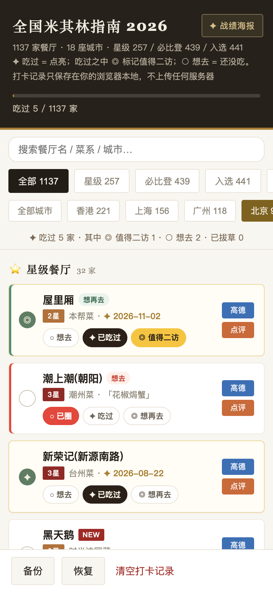
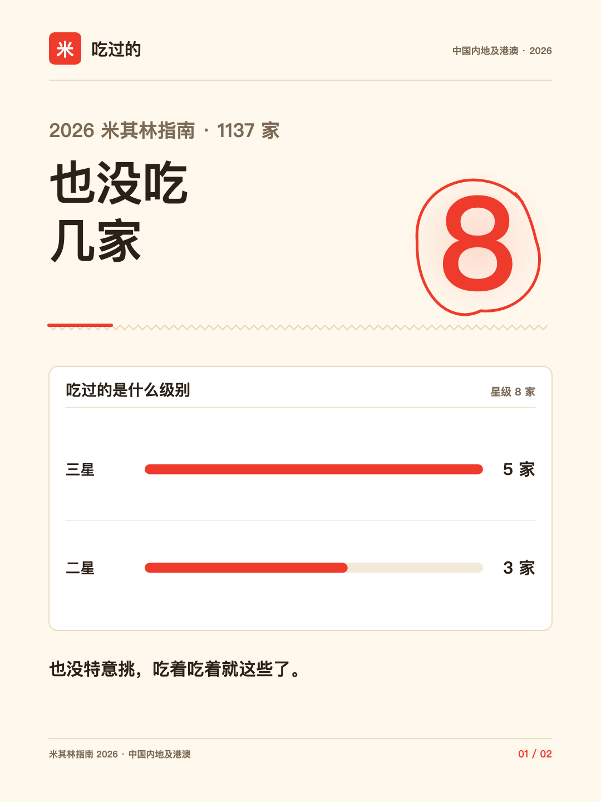
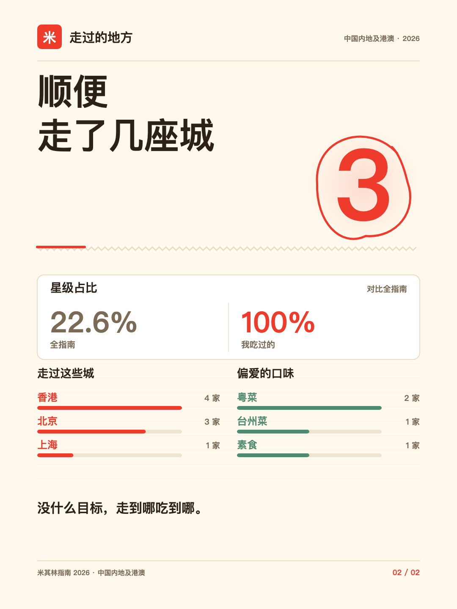

# 我把 1137 家米其林做成了能打卡的清单

> 想统计「我到底吃过多少家米其林」这件事，目前没有一个地方能好好回答。
> 所以我自己做了一份：单文件、免登录、数据不上传。

---

## 一个很多吃货都遇到过的困境

米其林指南每年更新，2026 版在中国大陆和港澳一共 1137 家餐厅：257 家星级、439 家必比登、441 家入选，散落在 18 座城市。

问题是，这几年攒下来的「吃过的店」，没有人帮你记账。

- 打开米其林官方指南，能按城市、按年份一家家翻，但**没有「我的进度」这一栏**。它不知道你吃过谁，也不会告诉你吃完了百分之几。
- 打开点评和小红书，评价很多、攻略很多，但**信息是碎的**。今年三月吃的那家二星，躺在收藏夹第 47 条，你自己都忘了。
- 自己建个 Excel？可以，但 1137 行要手动录，评级一变全部作废，手机上还不好翻。

于是核心问题变得很具体：**这份榜单，我一共吃了多少家？还剩哪几家值得去？哪几家值得再去一次？**

没有现成答案，就自己做一个。

---

## 做出来的东西

一份 **1137 家餐厅的打卡清单**。打开就是一个按城市分组的列表，每家餐厅一张卡片：评级徽标、菜系、三个按钮。

三个状态，覆盖吃货的真实心理：

| 状态 | 含义 |
| --- | --- |
| ○ **想去** | 收藏心愿，可以写一句「想吃哪道菜」，也可以写「和谁去」 |
| ✦ **吃过** | 盖章，自动记下日期 |
| ◎ **值得二访** | 只有吃过的店才能标——它代表「我认可，值得再去」，不是「我去过两次」 |

还有个小心思：一家店从「想去」变成「吃过」的瞬间，会告诉你**惦记了几天**。三个月前种下的草，终于拔掉的时候，那个数字挺有意思的。

界面顶部是一条进度条：**吃过 X / 1137**。它不吵，但每次打卡都会动一点点。对整理癖来说，这大概是这份清单最上瘾的地方。

---

## 数据是什么规模

| 分类 | 数量 |
| --- | --- |
| 全部餐厅 | 1137 |
| 星级（三星 12 / 二星 46 / 一星 199） | 257 |
| 必比登推介 | 439 |
| 指南入选 | 441 |
| 绿星 | 8 |
| 新上榜 / 新晋 | 261 |
| 城市 | 18 |

香港 221 · 上海 156 · 广州 118 · 北京 99 · 杭州 88 · 成都 76 · 澳门 59 · 深圳 58 · 厦门 43 · 南京 41 · 苏州 38 · 福州 31 · 台州 30 · 温州 24 · 泉州 18 · 扬州 16 · 常州 16 · 宁德 5

不止能看总数：按评级筛（星级 / 必比登 / 入选），按城市筛，再叠加「只看吃过的」「只看没吃过的」「只看想去的」「只看想再去的」，四个维度交叉，出差前五分钟就能列出「这座城市我还剩哪几家星级没吃」。

---

## 三个真实用法

**出差前**：选城市 → 点「只看没吃过的」→ 按星级排序。晚上那顿饭就有了着落，而不是打开地图随便找一家。

**年度盘点**：年底点「只看吃过的」，从最新日期往下翻。这一年吃了什么、哪几家标了「值得二访」，一目了然。想发朋友圈炫耀也行，数据是你自己的。

**心愿清单**：看到榜单里一家想吃的店，点「想去」，写一句「想试那道花椒焗蟹」。下次不知道吃什么的时候，筛「想去」，比翻收藏夹靠谱。

---

## 打完成，还有一张能发出去的战绩

打卡这件事，一半是给自己看，一半是给别人看。

点右上角的「✦ 战绩海报」，会生成两张 1080×1440 的图——小红书 3:4，发朋友圈也正好：

**第一张 · 吃过的**
巨大的数字是总数，下面是「吃过的是什么级别」：三星 / 二星 / 一星 / 必比登 / 入选，每一级各多少家，条形图一眼看完。

**第二张 · 走过的地方**
去过几座城；星级占比和全指南做对比——「全指南 22.6%，我吃过的 100%」这种反差，比任何文案都有说服力；再往下是走过哪些城市、偏爱什么口味。

  
  

几个刻意的设计：

- **只放「吃过」和「值得二访」**。想去、惦记、拔草一律不进海报——那些是给自己看的，不是发给别人的。
- **不放「还需努力」式的自谦**。收尾只有一句：「也没特意挑，吃着吃着就这些了。」低调，但信息量足够。
- **不放操作说明**。图是拿来发的，不是拿来教人用的。
- 纸质底纹、一笔手绘圈、收据撕票边——看起来像一张真的战绩单，而不是数据截图。

生成后可以左右滑动翻页，也可以点「下载全部」一次存两张，按顺序发出来就是一篇轮播。

---

## 几个刻意的取舍

**不做地图。** 这份清单不含坐标、不含地址，也不接任何地图服务的数据。卡片上的「高德」「点评」按钮只是按餐厅名 + 城市跳转到站内搜索。想看导航和评价，跳过去就好；清单本身只负责「我吃了多少、还差哪些」。

**不做账号。** 没有登录、没有云端、没有埋点。所有记录存在浏览器的 localStorage 里，断网能用，飞机上能用，服务器挂了也能用。代价很明确：换设备要手动「备份」成 Excel，再到新设备「恢复」导入。这个代价我认为值得。

**数据是非官方的。** 整理自米其林指南公开发布的信息，1137 家逐条核对过，但榜单每年变，错漏在所难免。所以它欢迎纠错——这也是下面要说的事。

---

## 怎么开始用

三种方式，从轻到重：

1. **直接在线用**：<https://nonlinearhuman.github.io/michelin-checklist-2026/>，手机电脑打开就能打卡，不用下载。
2. **下载离线版**：把 `index.html` 和 `vendor/` 目录一起保存到本地，浏览器打开。iPhone 可以「添加到主屏幕」，和 App 没区别；整个仓库没有任何外部请求，飞行模式也能打卡和备份。
3. **托管到自己的 GitHub Pages**：Fork 仓库，开 Pages，得到一个自己的网址，手机电脑都能开（记录仍在各自浏览器本地）。
4. **自己改**：数据在 `data/michelin-guide-2026.json`，页面由 `script/build.js` 生成。想换配色、加字段、甚至换成黑珍珠或亚洲 50 最佳榜单，改完 `node script/build.js` 重新生成即可。

---

## 欢迎反馈，尤其是纠错

一个人整理 1137 家，一定有错。**数据纠错和真实使用反馈，是这件事最需要的两样东西。**

仓库里已经准备好三类 Issue 模板：

- **餐厅数据纠错**：评级错了、名字不对、店已经关了、榜单里漏了——填城市和餐厅名，附个来源链接，核实后就改。
- **功能建议**：你希望它多做什么，或者哪里用着别扭。「用起来不顺手」和「想加功能」一样重要。
- **使用问题**：打不开、记录不见了、备份失败。写清设备和浏览器，方便复现。

也欢迎直接开 Discussions 聊聊：你会怎么用这份清单？还缺什么？

如果它帮你把「我吃过多少家米其林」这件事说清楚了，点个 Star 就是最好的鼓励。

---

## 许可

- 代码：MIT，随便用、随便改、随便商用。
- 数据：整理自米其林指南公开信息，不主张版权，不适用 MIT，详见 `LICENSE-DATA.md`。
- 「米其林」「必比登」等名称与标志归 Michelin 所有，本项目与其无关联、未获其认可。

---

**1137 家，你吃过几家？**
